# 验证记录

本次验证使用 Python 3.12 独立环境，前端通过 Vue TypeScript 类型检查和 Vite 生产构建。

- 自动化测试：37 项，通过。覆盖两种入库状态机、提交／移动超时、重启恢复、重复提交、跨来源去重、中文索引、消息修订与删除墓碑、全历史游标、Telegram 限流、完整分享文件树、同名冲突、扫描占用、STRM 文件核验、通知失败、扫码方法与参数、HTTP 登录和同源校验；补充了原生 115 状态恢复、STRM 自动展开路径及链接内提取码传递测试。
- 实际 Nyaa 搜索：返回 75 条结果，包含有效 BTIH、大小、清晰度、发布时间和做种数量；通过页面的 SSE 搜索显示相同结果。
- 浏览器：测试环境完成登录、搜索和页面切换，无控制台错误。390px 手机视口下页面没有横向溢出。
- 本机接入：OpenList、115 Open 挂载、媒体目录和 Emby 公共信息接口可访问。核对了 115 挂载账号与网盘根目录，STRM 驱动输出路径为应用默认设置。
- LaunchAgent：已启动，健康检查返回 `status=ok`。服务标签为 `asia.viol1n.medialink`。

## 外部账号验证边界

Telegram 尚未配置 API ID / API Hash 并登录；115 分享转存尚未完成独立账号登录。因此这两项已通过隔离测试，但尚未执行真实账号同步／转存。

115 磁力实测使用 WebTorrent 提供的公开测试影片，写入专用 `/115/infuse/MediaLink验证`。第一份样本被 OpenList 判定为已有离线任务，已停止本地验证流程并保留记录和暂存区。已取消流程不自动清理云端文件。

第二份样本（任务 `6848e668-10a6-481c-9ea2-f59bb2eccde2`）完成真实链路验证，终态为 `completed`。115 原生任务状态为 2、进度 100%，infohash 与 UUID 暂存目录均一致。移动前核对文件总计 276,445,467 字节，移动后保持原目录 `Big Buck Bunny`：

| 文件 | 115 中大小 |
| --- | ---: |
| Big Buck Bunny.mp4 | 276,134,947 字节 |
| poster.jpg | 310,380 字节 |
| Big Buck Bunny.en.srt | 140 字节 |

本地输出 `strm/infuse/MediaLink验证/Big Buck Bunny/Big Buck Bunny.strm` 为 160 字节，字幕为 140 字节。应用核验 STRM 后调用 Emby 刷新接口成功，保存了 `notified_at`。这里验证的是刷新请求接受，不代表 Emby 已完成刮削。

本机 OpenList 4.2.6 的单来源 STRM 挂载已自动展开，实际虚拟目录为 `/115Strm/MediaLink验证`。应用增加了挂载配置核对与可访问性检查，兼容 `/115Strm/infuse` 配置，无需修改现有 OpenList 服务。使用兼容处理后扫描此目录，返回 `obj_count=3, is_done=true`，STRM 和字幕保持完整。

测试影片来源：[WebTorrent Free Torrents](https://webtorrent.io/free-torrents)。

## 界面预览

以下为隔离测试环境截图，界面使用实际 Nyaa 搜索结果：

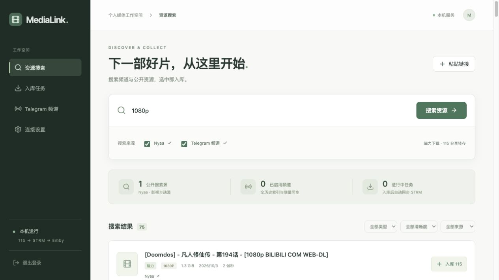

## 2026-10-03 扫码登录修复

- 删除当前 p115client 已不支持的 `check_for_relogin` 初始化参数，修复扫码确认后构建会话失败。
- 使用 `login_status` 验证实际 Cookie 会话，再与 OpenList 核对账号；不再使用默认查询 UID 11500 的公共资料接口判断账号。
- 服务端扫码轮询串行化，前端等待本次请求结束再安排下一次。已确认的登录信息只在内存中保留，连接验证失败后可继续验证，不必重复获取登录结果。
- 上游拒绝登录、IP 登录异常和验证超时返回明确提示，不再伪装成持续等待。错误提示不包含凭据或上游原始响应。
- 新增 6 项回归用例，累计 32 项通过；前端类型检查与生产构建通过。真实二维码获取和 SVG 生成成功；本轮完成登录仍需用户在手机重新扫码确认。

## 保存位置文件夹管理

- 保存位置选择器提供新建文件夹、列表内重命名、重命名当前目录。创建后自动选中，重命名后同步选择路径及记忆路径。
- 新增 5 项测试，累计 37 项通过；校验名称、媒体目录边界、同名文件／目录冲突、活动任务及其子目录保护、重命名超时、禁止覆盖请求参数。
- 隔离测试页面连接真实 OpenList，在 `/115/infuse/MediaLink验证` 内创建 `文件夹操作验证`，重命名为 `文件夹功能已验证`，页面保存位置正确跟随变化。未提交新的下载任务。
- 390px 手机视口下弹窗和按钮可见，无横向溢出。前端类型检查和生产构建通过。

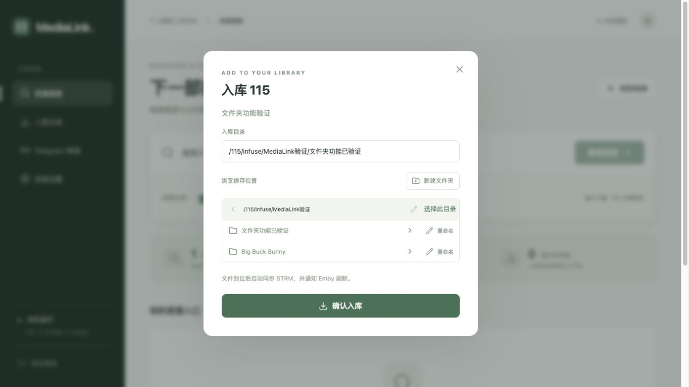

## 2026-10-03 公开网页频道与新磁力源

- 自动化测试累计 64 项，覆盖 Knaben 类别和磁力校验、1337x 过滤、LimeTorrents 广告排除与详情并发、单来源失败／超时、跨来源去重及搜索结果提交入库。
- 公开网页测试覆盖中文和隐藏链接、提取码、不可读消息、历史游标重启续传、跨页新增、消息编辑不误删、暂停时不推进、整页事务回滚、无效翻页、限流等待和 API 工作线程模式隔离。旧频道迁移保持 API 模式和索引；启动前 SQLite 备份及文件权限也已测试。
- 真实搜索关键词 `Big Buck Bunny`：Knaben 返回 1 条，LimeTorrents 返回 20 条；所有返回的磁力 BTIH 都有效，并保留来源。
- 使用隔离临时数据库读取 `https://t.me/s/telegram`，公开模式两页索引 40 条可见消息，历史游标从 441 推进到 420；未填写个人 API 凭据。
- 后端 Ruff 检查、Vue TypeScript 类型检查和 Vite 生产构建通过。生产部署前自动备份 SQLite，继续使用原 LaunchAgent。

- 隔离浏览器中用测试账号验证 Knaben 实际 SSE 结果显示、无需 API 的频道添加、暂停及恢复。Telegram 官方频道最终完成 409 条网页可见消息索引，页面明确标记“可见历史回溯完成”。
- 手机 390px 视口下搜索页和频道页无横向溢出；默认公开模式隐藏未登录的 API 频道选择按钮，个人 API 配置折叠。浏览器控制台没有错误。

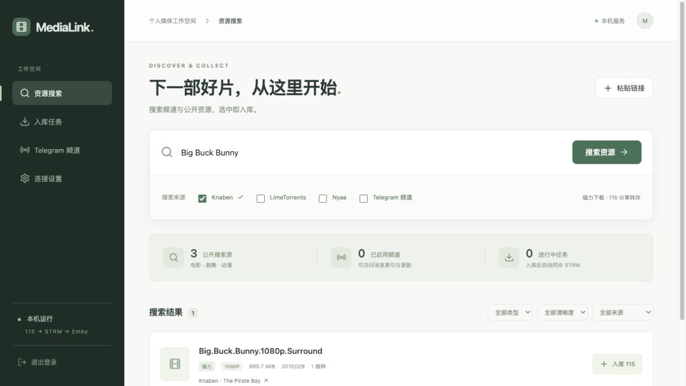

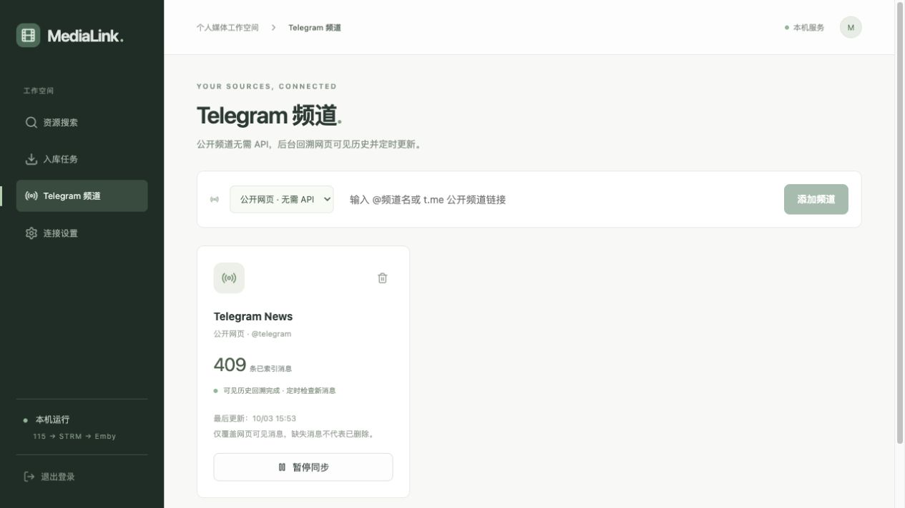

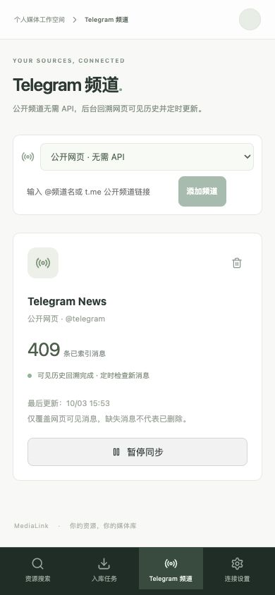

## 2026-10-03 LimeTorrents 空结果误报修复

- 确认 `电影` 和不存在的关键词返回包含搜索表单、查询标题与 `No results found` 的正常页面，旧解析器因缺少结果表格而误报验证。修复后返回空列表，继续使用 120 秒缓存。
- 搜索与详情响应先识别 `cf-mitigated: challenge` 或明确验证页结构，再处理 HTTP 状态；正常页面的 Cloudflare JavaScript 检测脚本不作为人机验证证据。无法识别的页面仍报错，避免误当作空结果。
- 真实验证、网络失败、页面变化、详情缺少有效磁力分别提示。部分详情被验证阻挡时保留成功结果，所有详情失败时显示已识别的原因。未接入自动解验证或浏览器验证会话。
- 新增 24 项回归用例，全部后端测试累计 88 项通过；Ruff、Vue TypeScript 检查和 Vite 生产构建通过。测试覆盖 HTTP 200／403 验证、正常检测脚本、未知页面、无效磁力、详情部分失败、空结果缓存及 SSE 来源隔离。
- 真实访问：`电影`、`medialink-nonexistent-20261003` 各返回 0 条，`Big Buck Bunny` 返回 20 条且磁力 BTIH 全部有效。真实验证用模拟响应测试，没有尝试完成 CAPTCHA。
- 隔离浏览器验证正常空结果提示，以及验证报错时其他来源结果仍可入库。390px 手机视口无横向溢出，错误提示完整可见，控制台无错误。以下截图使用模拟来源，不代表生产账号或真实下载。

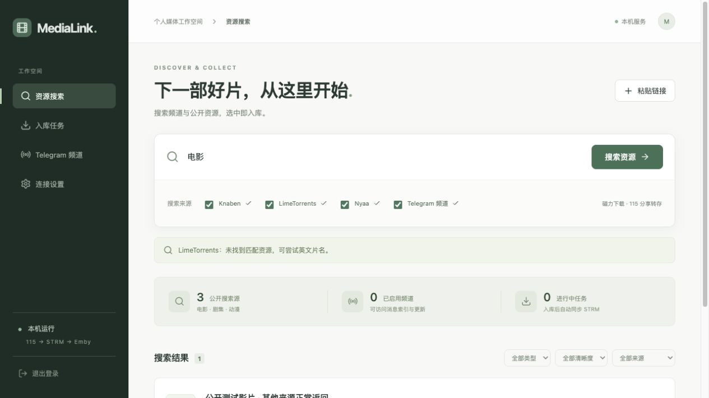

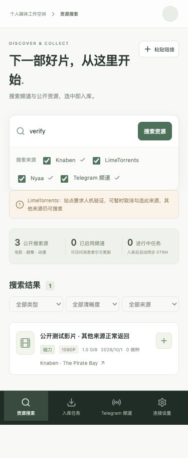

## 2026-10-03 TMDB 影视发现与片名辅助

- 后端累计 **132 项通过**，本次新增 44 项：唯一精确匹配、同名年份、电影与剧集同名、候选不完整分页、模糊匹配、全半角／标点、数字片名、非英语原名与译名缺失、英文简介回退、TMDB 不可用时原词照常搜索。
- 覆盖原词先开始、多片名去重与逐批 SSE、中文数字季名／`S02`、片名／年份／季数排序、短英文名的词边界、部分变体失败、整体超时保留结果、单源失败隔离，以及详情 SSE 资源通过模拟 OpenList 创建现有入库任务。
- 缓存跨实例／重启仍可用；429 遵守 `Retry-After` 并返回带原更新时间的旧缓存；503 可回退旧缓存。授权检测不接受旧缓存。Token 放请求头，API Key 仅用于固定 API 上游；错误提示不包含密钥、上游正文或带密钥地址。保存／清除不会写入 SQLite 设置，旧任务在新增缓存表后保留。
- 图片代理要求登录，拒绝任意域名、目录穿越、嵌套路径、查询参数、非法尺寸、SVG、HTML 和重定向，固定上游不会收到 API 凭据；验证图片缓存与 LRU 清理。
- Ruff 静态检查、Vue TypeScript 检查、Vite 生产构建通过。没有新增依赖，沿用现有锁文件。测试输出有已有的 Starlette/httpx 测试客户端弃用提醒，不影响用例通过。
- 浏览器使用 **隔离临时数据库、内存凭据和模拟元数据／资源服务**，未连接生产入库工作线程。图片路径来自 TMDB 官方公开影片页面，经应用图片代理实际获取并缓存；这些截图展示界面，不代表当天趋势、真实评分／演职员或下载结果。
- 桌面 1280px 与手机 390×844px 验证默认本周趋势、今日／电影筛选、分页及海报占位、图片懒加载、独立详情地址和刷新、第二季重新搜索、返回恢复原筛选／13 张已加载海报／滚动位置。手机海报双列、无横向溢出；五个底部导航入口均可见可点击。
- 普通搜索同名候选可手动选择，已识别卡片显示实际中英文词，更换影片保留原候选，“仅搜原词”关闭辅助。快速从剧集切到另一电影后只显示新影片资源，旧 SSE 不串入。模拟的详情资源通过保存位置弹窗创建一个本地等待任务，无生产云端下载。
- 检查连接检测提示、官方标识和标准署名；未配置时发现页有设置入口，资源搜索继续可用，浏览器无控制台错误。
- **真实 TMDB API 验收待有效凭据**：本机 Keychain 尚未配置 TMDB。没有申请账号或保存真实 TMDB 凭据；生产页面会引导至设置。真实授权、趋势与影片译名需配置后检测。

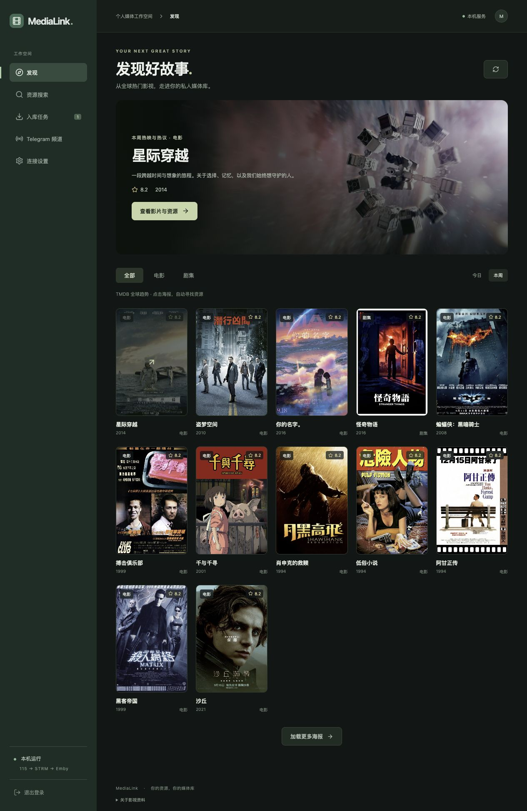

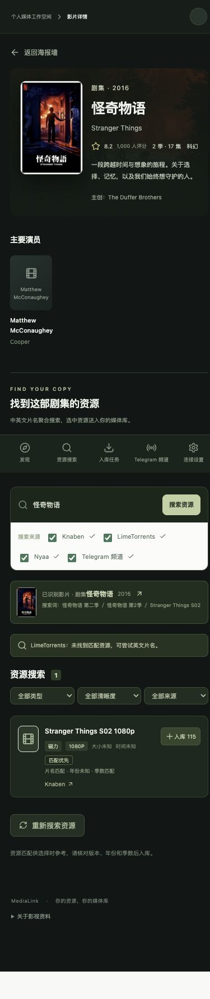

## 2026-10-03 Nyaa 空结果误报修复

- 正常零命中页面没有 `table.torrent-list`，但包含搜索表单、`No results found` 和 `Displaying results 0-0 out of 0 results`。解析器改用 HTML 结构判断，完整空结果页面返回 `[]`，保留 120 秒缓存；单独空结果文字、空白响应、未知统计或脚本里的表格类名不会当作成功。
- 保留原有类别过滤、有效磁力校验和资源信息解析，以及代理、18 秒请求超时、两秒请求间隔。HTTP 错误和网络失败继续提示，不缓存失败响应。未改变接口、数据库、资源结构或前端界面。
- 新增 **22 项回归测试**，全后端累计 **154 项通过**；Ruff、Vue TypeScript 检查和 Vite 生产构建通过。覆盖空结果缓存与过期、未知页面、HTTP／网络错误、正常磁力与类别过滤、SSE 来源隔离，以及 TMDB 中文查询为空后继续英文查询。SSE 空结果来源最终为 `done` 且无 `error`，有结果的其他来源保留。
- 实际使用应用适配器和当前代理设置访问 Nyaa：`medialink-nonexistent-20261003`、`Big Buck Bunny` 各返回 0 条且重复请求命中空结果缓存；`电影` 返回 70 条有效影视磁力，全部 BTIH 与资源标识一致。没有提交新的下载或转存任务。

## 2026-10-03 发现页影视分类筛选

- 完整后端 **178 项通过**，本次新增 24 项：电影／剧集 Discover 参数、包含类型交集与排除、无效或冲突类型、年份与范围校验、地区与原始语言、分页、零结果缓存、条件组合缓存隔离、排序规范化、跨实例持久化、429 旧缓存与 `Retry-After`、HTTP／结构错误、登录保护及旧任务接口兼容。
- 国家与语言配置端点允许数组响应，其余 TMDB 端点继续要求对象。选项缓存 24 小时，分类结果 30 分钟；复用原缓存表，没有数据库迁移或依赖变化，沿用两份锁文件。缓存不包含凭据；客户端仍走登录保护与固定 TMDB 上游。
- 已配置凭据，真实 TMDB 请求返回 19 种电影类型、251 个国家／地区、187 种语言。组合“剧情＋科幻，排除恐怖，2010–2019 年，美国，英语”返回 20 部第一页结果、41 页，含《银翼杀手2049》《星际穿越》《铁甲钢拳》；第二页正常。剧集“2020 年起、日语”返回 20 部及分页。选择所有电影类型并限定 2026 年返回零条成功结果，不误报访问故障。
- 自定年份限定四位年份 1000–9999；实测上游会忽略 `0001` 日期，因此在提交前明确拒绝这类年份，避免显示不符合年代的结果。“更早”使用上限 1959 年，不使用无效下限。
- 桌面 1280×1000、手机 390×844 验证热门／分类切换、默认本周热门、电影默认分类、分行标签、手机更多展开、双列海报、无横向溢出、类型包含／排除互斥、自定年份错误提示、一键重置、切换影视类别清除不适用类型并提示。
- 隔离服务使用临时 SQLite、内存登录凭据、模拟资源和 OpenList，未运行生产入库工作线程。验证分页加载 13 张海报后进入详情，返回仍保留条件和海报；点击海报时保存的滚动位置恢复。模拟详情资源通过保存位置弹窗成功创建等待任务 `/115/infuse/电影`。
- 用慢“美国”响应与新“日本”响应模拟快速切换，最终只展示“最新请求：日本”；模拟 503 显示重试按钮而不显示零结果，重试后恢复；“近两年”模拟零命中显示“没有符合条件的影视”及清空筛选。
- 最终截图使用隔离服务、真实 TMDB 凭据／元数据／图片接口，展示真实组合筛选，资源服务仍为模拟。图片经过应用登录保护的代理加载；截图不代表实际下载或入库结果。临时浏览器视口与服务在验收后恢复／停止。
- Vue TypeScript 检查、Vite 生产构建、Ruff 及 Git 空白检查通过；浏览器没有 JavaScript 错误。本次只增加发现分类入口，继续复用详情、资源搜索与入库链路。

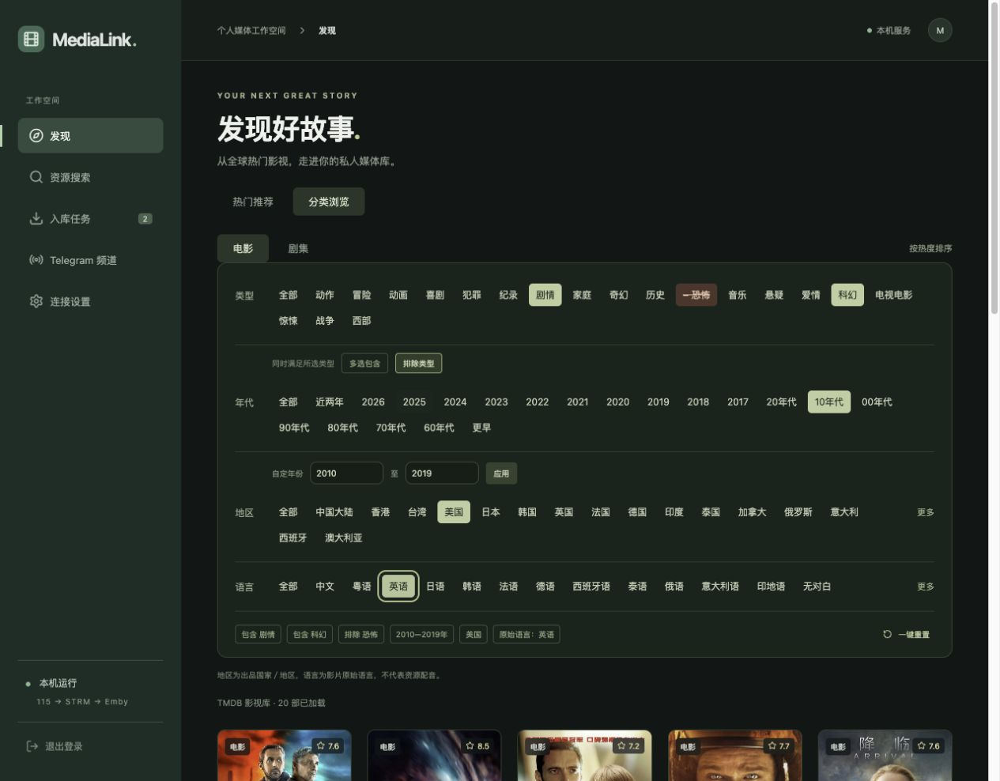

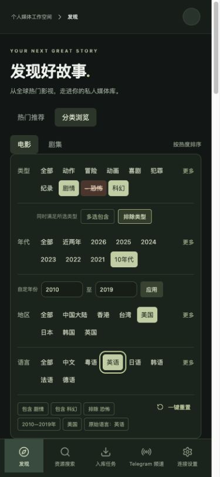

## 2026-10-03 搜索结果优先高清晰度

- 后端完整 **187 项通过**（本次新增 9 项），前端 `npm test` **6 项通过**。覆盖 8K、4K／2160P、1080P、1080I、720P、480P、未知／未识别值、大小写／空白归一、同档匹配分数、同分稳定顺序、不修改输入数据、不同资源类型，以及年份／季数冲突继续保留提示。
- 普通无 TMDB 搜索、辅助搜索、影片详情均使用同一排序规则。异步测试确认 1080P 先到、2160P 后到时上移，8K 最后到时再上移；跨来源去重与分批 SSE、HTTP `done` 最终结果仍排序。类型／清晰度／来源筛选保留顺序。
- 前端最终快照会更新资源字段并删除最终集合中不存在的旧条目，保留同档同分条目已有的相对顺序；单元测试验证晚到高清上移、最终同分不跳位、来源和命中词合并、字段更新后重新排序。
- “匹配优先”改为“已匹配”，列表显示“清晰度优先 · 2160P 与 4K 同档”。继续使用已有清晰度字段与匹配说明，没有改变识别规则、接口结构、数据库或入库链路，没有新增依赖，现有锁文件继续有效。
- Ruff、Vue TypeScript、Vite 生产构建及 Git 空白检查通过。桌面 1280×1000 与手机 390×844 使用临时 SQLite、内存凭据、模拟 TMDB 元数据／搜索源和 OpenList，未启用生产入库工作线程；海报路径复用公开 TMDB 图片。浏览器验证普通原词搜索、TMDB 辅助、详情自动资源搜索与三种筛选；结果顺序为已匹配 4K、年份冲突 2160P、已匹配 1080P、1080I、720P、未知。手机无横向溢出，控制台没有 JavaScript 错误。
- 截图使用模拟资源，不代表真实资源内容或云端下载结果。测试视口已恢复，临时浏览器已关闭。

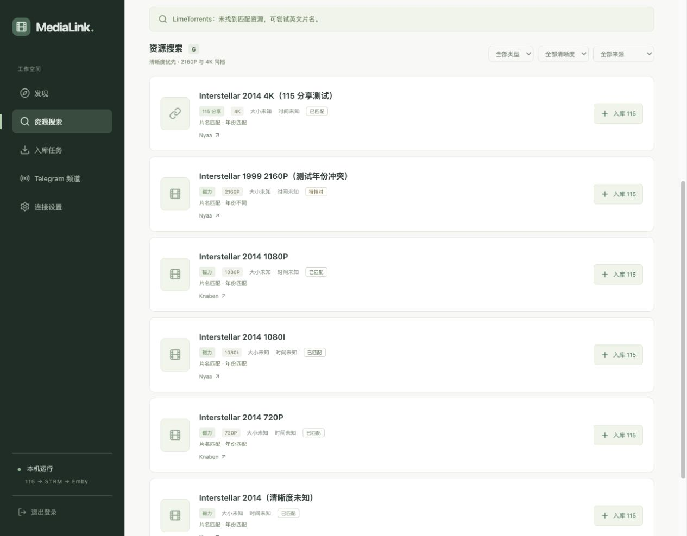

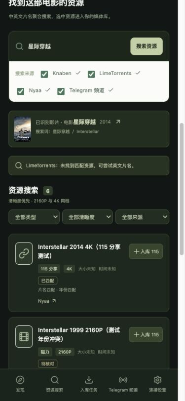

## 2026-10-04 设置页面重构（发布前验证）

- 搜索偏好保存在 SQLite，新增启用来源列表和普通搜索 TMDB 辅助默认值。旧配置缺少字段时延续全部五个来源及开启辅助。来源目录 API 保持完整，普通搜索和影片详情只展示启用来源；后端校验停用来源。允许全部关闭，频道同步、凭据和手动入库继续保留。
- 新增修改访问密码接口，验证当前密码、沿用 scrypt／Keychain 和登录限流。成功后清除所有会话和当前 Cookie。登录／改密串行化，覆盖并发旧密码登录；搜索 SSE 检查会话，失效后发送 `auth_required` 并结束，前端退出并清理页面状态。Keychain 保存失败保留原密码与原登录会话。
- 桌面 1280px 和手机 390×844px 验证四个页签，未发现横向溢出或浏览器页面异常。截图使用测试数据。
- 新构建放在独立目录验证。运行中的服务读取 `frontend/dist`，构建验证曾更新该目录，随后已恢复改动前的页面构建并核对首页资产、健康检查均为 HTTP 200。没有重启 LaunchAgent，没有修改生产数据库配置、访问密码或账号凭据。以上为发布前验证记录；独立构建与浏览器验证命令见 README，部署结果见下节。

## 2026-10-04 设置新版部署

- 按用户要求发布当前新版前后端。前端类型检查及生产构建通过，生成 `index-DCyXVyvC.js` 与 `index-CS3A2tJo.css`。通过现有 `scripts/start.sh` 自动备份 SQLite 后重启原 LaunchAgent；服务进程从 25331 更新为 27783，状态为 `running`。
- 首页、新 JS／CSS 与健康接口均为 HTTP 200。生产设置接口返回新搜索偏好字段，默认启用来源数为 5；改密 POST 路由已注册，未登录访问仍返回 401。
- 使用临时本机验收会话检查实际运行页面：四个设置页签、搜索源开关、修改密码表单和 390px 手机布局均正常，无页面异常；浏览器未提交业务写请求。验收会话结束后已清除，没有实际改密、修改偏好或提交入库任务。
- 刷新现有页面即可使用新版设置：`http://127.0.0.1:8766/#/settings`。

## 入库可选规范命名（2026-10-05）

- 入库弹窗增加“自动规范命名”复选框，每次打开默认未勾选；勾选后显示 TMDB 关联及电影清晰度选项。搜索、电影／剧集详情和手动链接共用该选项。
- 创建任务 API 增加 `auto_naming`，默认 `false`。未启用时不读取 TMDB 或生成命名计划，保留原文件名及目录层级，继续移动、核对原名 STRM 和通知 Emby；启用后沿用原命名流程，已有任务保留已保存的计划。
- 85 项相关后端回归、13 项前端测试及 9 项隔离浏览器回归通过。浏览器覆盖四个入口的勾选／未勾选提交、再次打开恢复未勾选、390px 无横向溢出及既有命名信息修正；API 回归覆盖磁力／分享默认与显式关闭、跳过 TMDB、重启读取、原名 STRM 核对及 Emby 通知。
- Vue TypeScript、Vite 构建、Ruff 与 Git 空白检查通过。测试使用临时数据库及模拟服务，未提交真实入库任务。

## 磁力文件预览与勾选入库（2026-10-06）

- 入库弹窗自动解析磁力元数据，展示可展开的目录树、大小、已选数量和大小。默认仅选择视频与字幕，支持逐文件／目录选择、全选、清空；未选择视频时禁用确认。解析失败可重试或明确改为整包入库，确认前不提交 115 下载。
- 新增 `libtorrent==2.1.1` 及对应 `uv.lock` 条目，使用 `upload_mode`、全零文件优先级和临时目录；不启用自动下载或网页种子源。真实本地 libtorrent 种子节点测试成功获取中文文件元数据，接收视频内容字节数为零，清理前没有视频文件。实测 `stop_when_ready` 会在元数据获取前暂停磁力，因此使用官方说明的 `upload_mode`，并在成功、失败、超时和取消时释放句柄及临时目录。
- 新增 `POST /api/v1/magnets/preview` 与任务可选 `magnet_selection`。解析并发上限为两条，同一 BTIH 合并请求，成功结果缓存 24 小时。校验 BTIH、路径、大小、文件数量、预览标识和所选视频；任务持久化可信清单，重启不依赖缓存。不同文件选择与同磁力同目标的已有任务冲突时返回 409；既有整包请求及 115 分享保持兼容。
- 115 仍整包下载；独立选中暂存区按文件移动，不移动包含未选文件的整个目录。保存计划后执行，每次核对源／目标和文件身份，部分结果、不确定响应或清单变化时暂停；剩余文件留在原暂存目录。只对选中文件命名，只等待选中视频 STRM，之后通知 Emby。任务详情显示数量和下载暂存路径。
- 全量后端回归 342 项通过，15 项需显式启用的浏览器测试跳过；前端 16 项通过；另外显式运行磁力与命名浏览器回归，12 项通过。覆盖两种根目录布局、同目录部分选择、跨目录选择、未选文件保留、命名、STRM、通知、移动超时及重启、身份变化、部分移动、空目录、过期预览、取消、并发、哈希不符及不安全路径。
- 浏览器使用隔离数据库和模拟云服务，不运行生产入库工作线程。桌面和 390px 手机截图已人工检查，无横向溢出及 JavaScript 错误；关闭弹窗能取消预览，重新打开恢复默认选择。Vue TypeScript、Vite 构建、Ruff、锁文件一致性与 Git 空白检查通过。

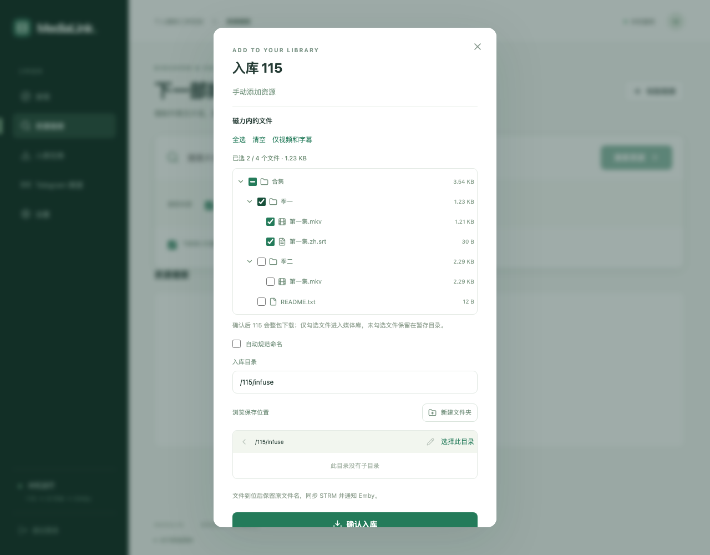

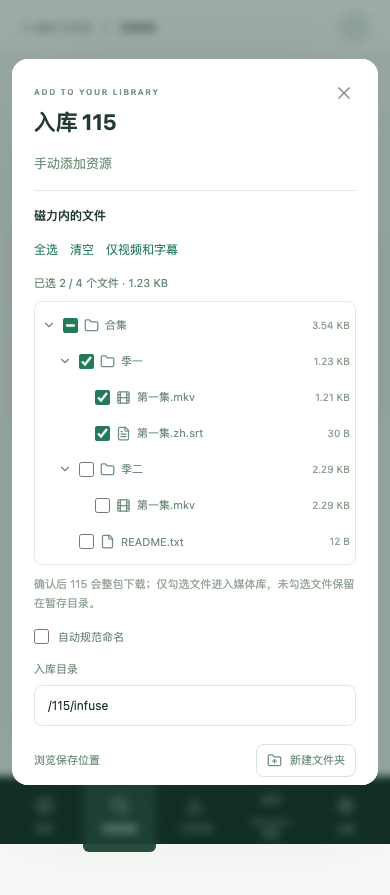

- 本机发布完成：通过现有启动脚本先备份 SQLite 再重启服务；健康接口与新版前端资源均返回 HTTP 200，资源包含磁力预览入口。重启前后任务状态数量一致，验收未创建生产入库任务。刷新页面后可使用新版弹窗。

## 磁力解析速度优化（2026-10-06）

- 定位到原解析器为每次预览新建／销毁 libtorrent 会话，反复进行 DHT 引导。现在服务启动时预热，共享常驻会话；取消、超时、成功仅移除该磁力句柄，不暂停其他预览或丢弃路由表。解析任务并发上限仍为两条。
- 仅保存 DHT 路由状态到现有元数据缓存，重启可恢复，缓存中不保存代理密码、会话设置或下载任务。代理变更后新预览使用新配置，已有预览继续使用原会话；空闲旧会话释放。链接已有 tracker 并行查询，新增官方 DHT 引导节点（参见 [libtorrent 设置说明](https://www.libtorrent.org/reference-Settings.html)）。
- 本机无代理网络诊断：DHT 在约 5 秒发现 161 个节点，40 秒发现 447 个节点。隔离数据库真实公网验证使用 Ubuntu 官方公开种子的 BTIH，仅经 DHT 获取文件列表，先预热 10 秒后解析用时 5.04 秒，缓存读取 0.0002 秒。该样本不代表冷门资源的耗时；未创建任何 115 任务。
- 新增会话复用、取消不影响并发预览、超时后重试、代理变更、路由状态恢复／损坏和凭据不进入缓存的回归。真实本地种子在预览缓存失效后再次解析，确认只创建一次会话，两次均无内容下载。后端 346 项通过（15 项浏览器用例默认跳过），磁力浏览器回归另行运行 3 项通过，前端 16 项通过；Ruff、Vue TypeScript 与差异空白检查通过。
# 大模型辅助规范命名（2026-10-06）

- 设置新增通用 OpenAI 兼容地址、模型 ID、Keychain API Key、启用开关及独立代理选择。保存、清除和固定样例检测独立处理，不覆盖其他设置草稿。
- 规则优先，仅补缺失字段；模型建议独立保存，50 文件分批，60 秒超时，网络调用在 worker 锁外。未知 ID、字段越界、非法 JSON、未请求字段和不完整响应均拒绝。
- 使用模型后必须确认当前修订的完整预览，保存修正和普通重试不能跳过确认。确认前再次核对清单，改名开始后沿用原计划锁定及远端结果核对。迟到结果不会覆盖人工修改或取消；中断请求不会因重启自动重复调用。
- 后端完整回归：**404 项通过，17 项按默认环境跳过**；其中新增大模型测试 **58 项通过**。前端 **17 项通过**，`vue-tsc` 和独立 Vite 构建通过；`ruff check backend tests`、`git diff --check` 通过。
- 启用真实 Chromium 的设置、命名、磁力浏览器回归 **16 项通过**。覆盖模型设置草稿隔离、密钥输入清空、检测读取已保存配置、预览草稿跨轮询保留、保存后仍待确认、手机无横向溢出。
- 浏览器使用临时数据库、内存凭据和模拟模型，不向真实大模型发送凭据或请求。截图：`llm-naming-desktop.png`、`llm-naming-mobile.png`。
- 最终确认保护与轮询更新后再次运行命名浏览器回归 **11 项通过**。正式前端已构建，使用现有启动脚本备份 SQLite 后重启本机服务；健康检查为 `ok`，服务提供的新前端包含大模型设置和确认按钮。

## 勾选文件入库移动超时修复（2026-10-06）

- 本机 OpenList 4.2.6 日志显示两次整季移动均在 25 秒时被取消，第一项移动报 `context canceled`。只读核对两个任务各 12 个源文件的大小及 SHA1 均与持久化清单一致，选中暂存目录为空；没有重新下载或恢复这些生产任务。
- 勾选文件改为逐文件移动，每项提交前保存记录，提交后核对源／目标、大小及文件身份。仅移动请求的读取超时提高到 120 秒；连接超时及其他 OpenList 请求仍为 25 秒，移动明确禁止覆盖。
- 已持久化的多文件分组拆为单文件记录，保留原状态、时间及确认信息。响应不确定时只核对；手动点击“重试当前阶段”后，已移动且核对通过的文件直接确认完成，只有已等待至少 180 秒、源文件身份及大小一致且目标无同名内容的剩余文件允许重试。无法核对时保持暂停，整批重试校验失败不会部分写入恢复状态。
- 发布检查发现原服务曾因文件句柄耗尽无法接受连接。SQLite 自身的上下文管理器不关闭连接；现在 Store 在事务提交／回滚后显式关闭连接，OpenList 的四处只读数据库访问也显式关闭。保留原事务及配置行为，不更改数据库结构。
- 最终完整后端回归 **432 项通过，17 项浏览器用例按默认环境跳过**；Ruff 与 Git 差异空白检查通过。覆盖 12 集及真实响应形态的 SHA1 字段、逐文件移动、超时后成功、重启、旧批量计划部分完成、冲突、大小／身份变化、身份缺失及手动重试。传输层用模拟 40 秒响应验证 HTTPX 超时配置，没有实际等待或提交生产移动。
- 连接释放回归覆盖正常提交、异常回滚、连接初始化失败、四处 OpenList 只读访问，并保留连接对象引用连续执行 150 轮轮询：300 个连接均已关闭，不依赖垃圾回收。

## 入库前命名预览与模型响应兼容（2026-10-06）

- 按要求先将已完成的磁力选择、大模型辅助命名、移动超时和数据库连接修复整理为 `4b1ff6a`，推送到 `origin/main` 后再开始本次修改；提交只包含源码、测试、文档、验收截图和依赖清单，不含数据库、凭据或运行缓存，没有强制推送。
- 四类入库入口继续共用“入库 115”弹窗，“自动规范命名”默认未勾选。启用后可关联 TMDB 并点击“大模型规范命名”，从可信磁力所选清单或只读分享目录生成异步预览，显示原名、规范名、依据及逐文件修正。没有清单时可继续原有流程；分析中、错误或未保存修改时禁用预览确认。
- 新增预览创建、轮询、修正、取消及重新识别接口。可信草稿保存在现有元数据缓存，输入链接和提取码密封保存，最后活动 30 分钟后过期；重启中断作业标记失败且不会自动再次调用模型。关闭弹窗和更换命名输入使旧作业失效，迟到创建响应也会被取消。提交任务时在网络校验前后核对草稿修订，避免修改／取消期间使用旧方案。
- “确认入库”同时确认命名方案，完整清单、原始目标、建议、人工修正和目录解析信息保存到任务。下载后按路径、大小唯一映射，兼容磁力根目录保留／省略，附加实际文件身份；重新生成名称与已确认方案一致时直接完成命名、STRM、Emby。清单变化、映射不唯一、名称或目录冲突时暂停到任务详情；既有任务方案变化返回冲突，旧请求和旧任务保持原流程。
- 修正输出示例为实际缺失字段，使用 `response_format:{type:"json_object"}`；仅服务明确拒绝该参数时移除参数重试一次。按[千问官方结构化输出说明](https://help.aliyun.com/en/model-studio/qwen-structured-output)核对当前配置支持 JSON 输出。兼容单层完整代码围栏、整数数字字符串、清晰度大小写和 4K／8K 别名、空字段及一致的已知字段回显；拒绝重复 JSON 键、未知／重复 ID、越界、布尔数字、冲突和路径。提示区分 JSON、字段类型／范围、ID、冲突、截断、拒绝等，不记录原始响应或密钥。
- 隔离进程只读取得截图中尼古喵喵任务的 12 个候选文件及已保存模型配置，未执行生产 worker、未修改任务或云端文件。旧客户端这次调用也返回有效结果，因此不能从未保存的历史响应确定唯一失败类别；原严格校验对数字字符串、代码围栏或相同季号回显的拒绝已用回归复现。修复后真实配置返回 12 项有效结果，集号为 1–12，规范计划错误数为 0。没有保存或输出原始模型响应、分享链接或 API Key。
- 回归覆盖分享与磁力预览、逐文件修正、再次识别、取消、过期、重启中断、迟到结果、两种根目录布局及目录信息保留、模型／人工 ID 映射、下载差异与冲突暂停、单次确认后完整入库、未选文件保留、旧任务兼容。浏览器使用临时数据库和模拟云服务，检查桌面和 390px 手机无横向溢出、分析时不能提交、修改未保存不能提交、改输入清除旧方案、关闭弹窗取消迟到创建响应，生产入库任务未恢复。
- 最终完整回归显式启用全部浏览器用例：**495 项通过**（包含 20 项浏览器用例）；前端 **17 项通过**。`vue-tsc`、独立 Vite 构建、`ruff check backend tests`、`git diff --check` 均通过。默认后端命令为 475 项通过、20 项浏览器按环境跳过。命令：`MEDIALINK_BROWSER_TESTS=1 MEDIALINK_TEST_FRONTEND_DIST=/tmp/medialink-naming-preview .venv/bin/pytest -q`；前端使用 `npm run build -- --outDir /tmp/medialink-naming-preview --emptyOutDir`，验证期间不覆盖运行页面。
- 功能提交 `5d44a94` 已推送。发布首次运行原备份脚本失败，尚未重启服务；定位到系统 Python 的 SQLite 3.51.0 可以读取数据库，但对带 `%20` 的只读 URI 执行在线备份报无法打开数据库。相同源文件使用项目运行时 SQLite 3.53.1 备份成功并通过完整性检查。备份脚本改为与服务相同的项目 Python，不改变在线备份、权限或存储位置；补充含空格目录及 WAL 数据库回归，备份和启动脚本两项测试通过。
- 用临时本机验收会话检查生产任务接口连续 10 次成功、预览路由已注册、缺少 TMDB 的创建请求返回 422 且未生成草稿。实际页面的 390px 入库弹窗显示默认未勾选及“大模型规范命名”入口，无横向溢出或 JavaScript 错误；浏览器未提交业务写请求。验收会话已精确移除，不改密码或既有会话。仅清理本次诊断创建的失败／重复备份，保留正式备份。

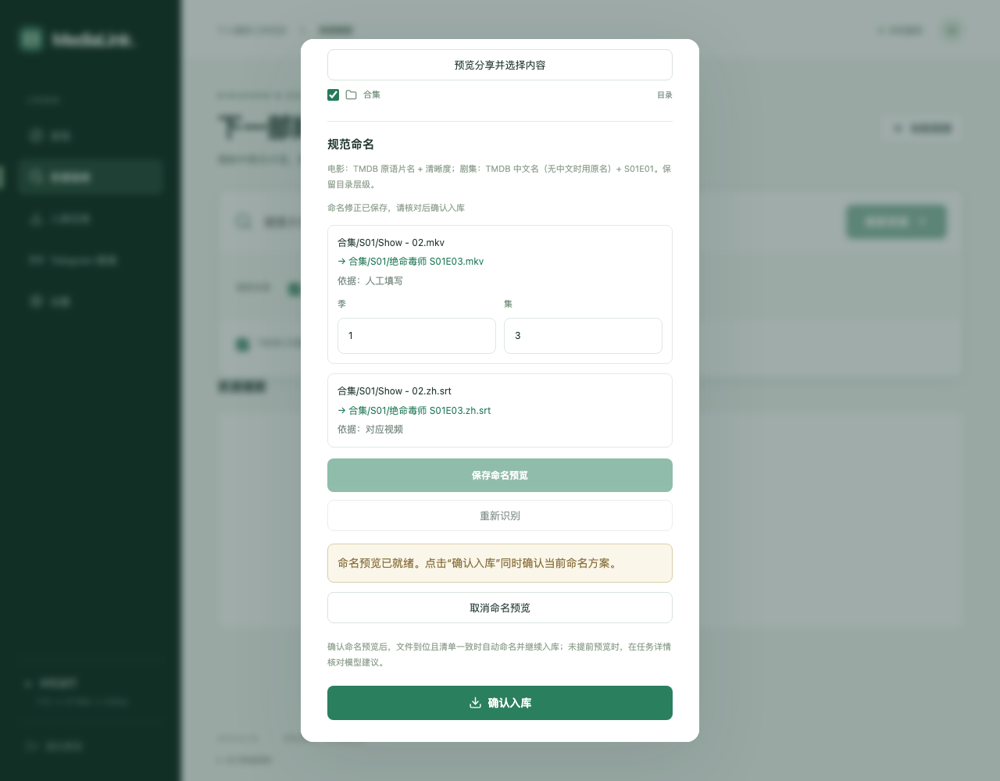

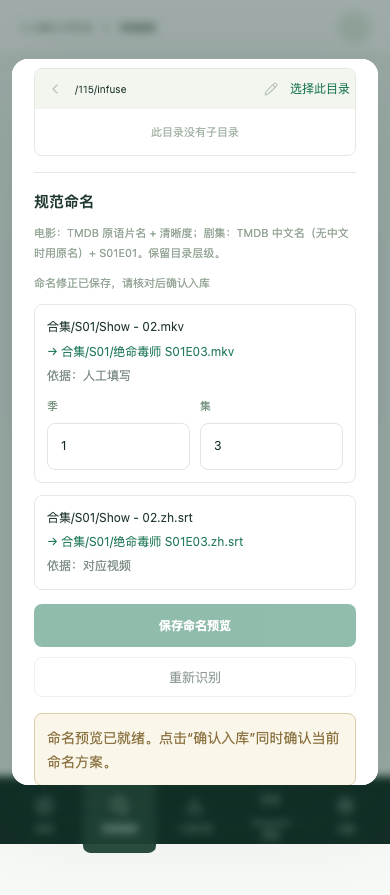

## 磁力解析卡顿优化（2026-10-15）

- 排查结论：服务由 launchd 以 256 个文件句柄软上限运行（空闲约 90 个），libtorrent 默认最多 200 个连接，两条并发解析即可能耗尽句柄，错误日志中已有磁力临时目录清理与 SQLite 同时报 `Too many open files`；解析跟随全局代理，HTTP 代理下 DHT／uTP／UDP tracker 失效；仅含 BTIH 的磁力只能依赖 DHT；超时预算包含排队时间；请求超时或关闭弹窗即移除种子，重试从零开始；DHT 状态保存、会话创建、临时目录清理在事件循环中同步执行；LaunchAgent 为 `Background` 低优先级。
- `run.sh` 启动前将句柄上限提升到 8192，LaunchAgent 改为 `Standard` 并写入 `SoftResourceLimits`。libtorrent 连接上限 120、连接超时 7 秒、关闭未读取的 alert 队列。
- 新增“磁力解析使用应用代理”开关，默认直连，仅接受布尔值；切换后下一次解析使用新会话，空闲旧会话保存 DHT 状态后释放。链接自带 tracker 之后合并 10 个公共 tracker，去重并限 30 个。
- 单次请求最多等待 60 秒，后台解析预算 180 秒且仅在取得名额后计时，并发上限 3。请求超时返回 504 与 `Retry-After`，后台继续解析；重试、重新打开弹窗或命名预览直接接上同一解析。预算耗尽返回 502 且不缓存。前端遇到可续等的 504 自动继续请求，最长约 200 秒，显示已等待秒数，可随时改为整包入库。会话创建、移除种子、DHT 状态保存（10 分钟节流）及临时目录清理均移出事件循环。
- 后端 485 项通过、20 项浏览器用例默认跳过；显式运行磁力、设置、命名预览浏览器回归 9 项通过（新增请求超时后自动续等）。前端测试、`vue-tsc`、Vite 构建、`ruff check backend tests` 通过。
- 隔离数据库、句柄上限 256 的真实公网验证：Sintel、Big Buck Bunny、Tears of Steel 仅用 BTIH（无 tracker）分别 3.0／1.6／1.4 秒得到文件列表，进程句柄稳定在 82 个；旧实现同样样本为 4.0／2.6／1.0 秒。高做种样本不能代表冷门资源，未复现冷门资源的卡顿场景；未创建任何 115 任务。

## 规范入库链路：下载后去广告与 Emby 标准目录（2026-10-16）

- 排查结论：本机只成功缓存过 4 个磁力预览，均为动漫种子；「高清影视之家／高清剧集网」等中文转发资源的元数据基本取不到，但 115 离线下载约 30 秒完成。整包入库后，广告视频 `【更多无水印高品质资源请访问 www.Butailing.com】.MP4/.MKV` 已生成 STRM 并进入 Emby；《海边的曼彻斯特》的 2 个广告视频与正片撞名，只能手填清晰度绕开；发布组外层目录原样保留在媒体库中。
- 新链路（仅限勾选自动规范命名的新任务，`pipeline: 2`）：115 整包下载 → 按实际文件清单分类筛选（广告、样片、花絮／特典、非影视、无法对应的字幕）→ 规则命名 + TMDB 校验（缺字段时调用大模型）→ 在下载暂存目录内原地改名 → 逐文件移入 `分类目录/中文名 (年份) [tmdbid=ID]/[Season NN]/` → STRM → Emby。排除的文件留在暂存目录，不删除。磁力预览改为可选且不阻塞提交；下载前的勾选只决定保留哪些文件。旧任务与关闭自动命名的任务流程不变。
- 模型补全的结果通过 TMDB 季／集数校验且无冲突时自动继续入库。新增规则：字幕组集号 `[05]`、`[02v2]`、` - 11 `，OVA／SP 归入第 0 季，单正片季默认，绝对集号换算。修复了 `1920x1080` 被识别为第 1920 季的问题（旧流程同样受影响）。
- 只读演练（`immutable` 方式读取生产数据库，不写入）：用新规则重建近期任务的计划。谍影重重保留 1 个正片，3 张广告 PNG 与 NFO 被排除；海边的曼彻斯特保留正片，2 个广告视频与 DOC 被排除，冲突消失；碧蓝之海第三季 12 集、尼古喵喵 12 集全部按规则识别。拔作岛 BD 合集中，11 集与 4 个 OVA（含 15 个字幕）被保留，26 个 YOKOKU、PV、NCOP／NCED、Menu、CM 与字体包被排除；补充 TMDB 季信息后 0 错误，无需调用模型。缓存的 4 个磁力预览的季集号全部正确识别。
- 新增 `test_curation.py`（分类、目录布局、季集规则、TMDB 校验、人工覆盖）和 `test_placement.py`（广告留在暂存目录、并入已有剧集文件夹、同名不覆盖、移动响应不确定后重启核对且不重复、模型结果自动继续或越界暂停、下载前勾选映射、换目录、API）。另新增浏览器用例：预览加载中关联 TMDB 后可提交；任务详情列出排除文件并可改为入库。原有预览／浏览器用例按新的默认勾选与目录布局更新。
- 完整回归显式启用全部浏览器用例：**553 项通过**（包含 23 项浏览器用例）；前端 **23 项通过**。`vue-tsc`、独立 Vite 构建（`/tmp/medialink-v2`，不覆盖运行页面）、`ruff check backend tests`、`git diff --check` 均通过。本次未重启生产服务，未创建 115 任务。

## 每日番剧与追番订阅（2026-10-17）

- 数据源为蜜柑计划：番表读首页 `div.sk-bangumi[data-dayofweek]`（0–6 为周日至周六，7 剧场版，8 OVA），往季读 `/Home/BangumiCoverFlowByDayOfWeek`；番剧页取字幕组与近期发布；RSS 的 `/Home/Episode/{BTIH}` 直接生成磁力。实测 2026 秋季 81 部，冷缓存时后台 TMDB 关联约 2 分钟完成，57 部自动关联；片名与 TMDB 中文名不同（如《用【循环利息】强制收回借出的魔力》对应 TMDB《借出去的魔力要用【分期还款】强制收回》）时不自动关联，订阅弹窗可手动搜索。
- 实测发现并修复：① `naming.season_numbers` 把 `2nd Season - 172` 中的 `Season - 172` 识别为第 172 季，与 `Season 2` 冲突导致集号缺失，旧入库流程同样受影响；现在 `Season` 后带空格连字符的数字不算季号，并识别 `2nd Season`。② 同一字幕组同时用季内集号（B-Global `- 01`）和绝对集号（ABEMA `- 171`）发布同一集；订阅按 TMDB 各季集数把绝对集号换算回季内集号后去重，TMDB 不可用时按原集号。③ 番表解析拒绝指向其他站点的番剧链接。④ 海报请求不再与页面／RSS 共用 3 秒间隔，最多 4 个并发。⑤ 手机底栏改为按项数自动分列，新增“追番订阅”后“设置”仍可见。
- 新增 `test_anime.py`（真实页面裁剪的番表／番剧页／RSS 夹具、单集与合集识别、规则与版本选择、逐集只提交一次、不补齐时跳过已播出集、新集后续提交、失败退避、绝对集号换算、重复订阅、番表缓存与过期回退、API 与设置校验）和前端 `anime.test.mjs`。
- 隔离验证：临时数据库、端口 8799、不启动 worker，只读复制生产设置并读取 Keychain。实际页面在桌面和 375px 手机均无横向溢出；默认打开今天（周六 13 部），订阅弹窗列出 8 个字幕组及近期发布、自动带出 TMDB《黑色五叶草》第 2 季与目录预览；不补齐订阅后 3 个已播出集显示“已跳过”，未创建入库任务。没有向 115 提交任何下载。
- 完整回归显式启用全部浏览器用例：**579 项通过**；前端 **29 项通过**。`vue-tsc`、Vite 构建、`ruff check backend tests`、`git diff --check` 均通过。设置浏览器用例按新增的 `mikan_url` 字段更新。

## 番剧 TMDB 自动关联改进（2026-10-17）

- 原匹配只比较蜜柑中文片名，TMDB 中文名不同时关联不上。现在中文片名未命中时，经番剧页的 bgm.tv 链接读取条目的原名、中文名和别名（`api.bgm.tv/v0/subjects/{id}`，走应用代理，`bgm:subject:{id}` 缓存 30 天），用原名再搜索 TMDB，并与 `original_title` 等比较；年份与类型限制不变。缓存键仍为 `mikan:tmdb:{id}`，记录带 `version`，此前缓存的未命中会重新搜索，命中不受影响；bgm.tv 或番剧页暂时不可用时记为旧版本，下次刷新再试。
- 同名重制（如 1994 与 2026 的《魔法騎士レイアース》、2004《ケロロ軍曹》与 2026《ケロロ軍曹☆》）原先取 TMDB 排序第一项，现在取年份最接近的条目。季号剥离新增 `第2期`、`第2クール`、`2nd Season`。
- 只读实测（生产数据库的临时备份，生产服务未改动）：2026 秋季 81 部，仅中文片名 57 部，加上 bgm.tv 名称后 **73 部**，新增 16 部逐一核对 TMDB 条目均正确。剩余 8 部为篇章副标题（如《东京复仇者 三天战争篇》《死神 千年血战篇-祸进谭-》），TMDB 归为原剧的一季，仍需在订阅弹窗手动选择。
- 新增 bgm.tv 条目夹具与用例：名称解析与缓存、404 与失败、按原名关联、旧未命中重新搜索、失败后重试、订阅建议直接使用番剧页的 bgm id、同名重制取最近年份。`uv run pytest` **559 项通过**（23 项浏览器用例按默认配置跳过），`ruff check backend tests` 通过，前端 **29 项通过**。未重启生产服务，未创建 115 任务。
